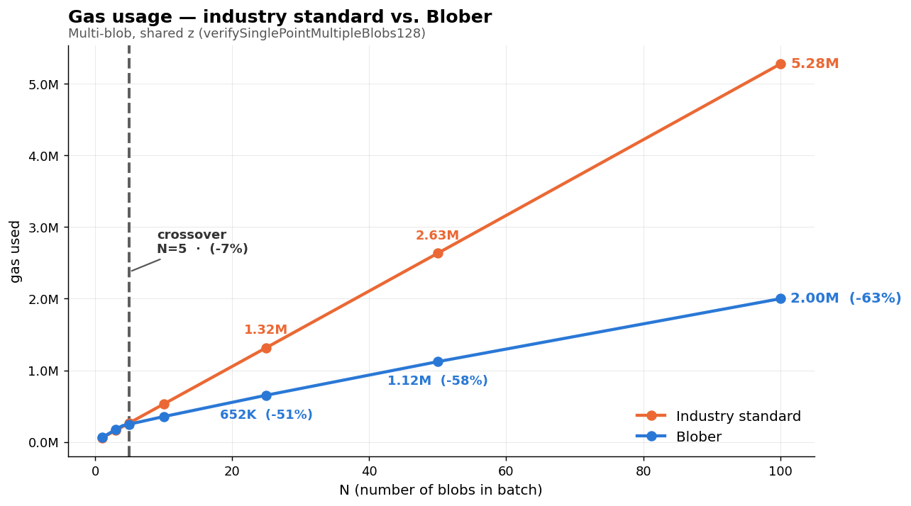
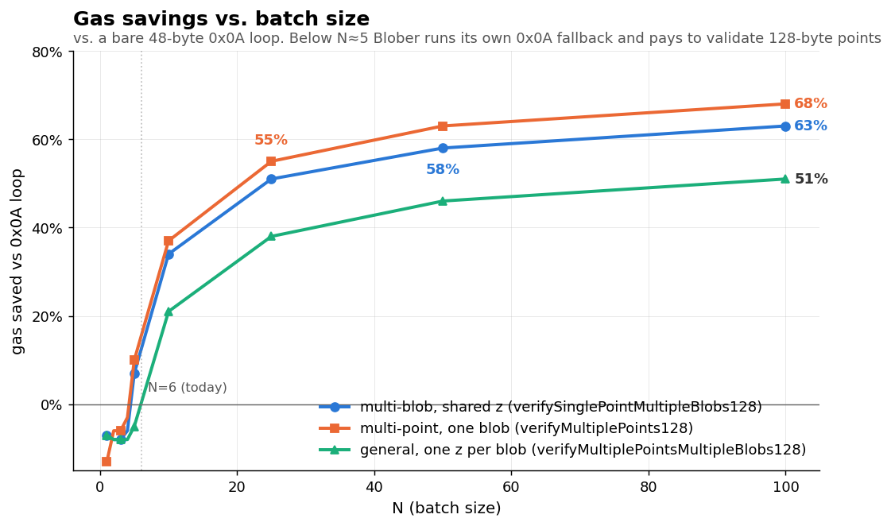
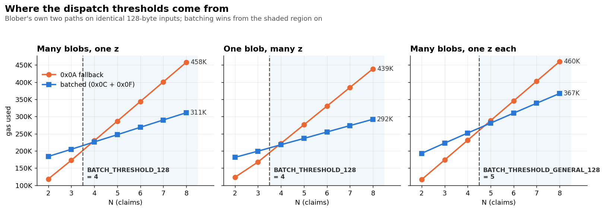
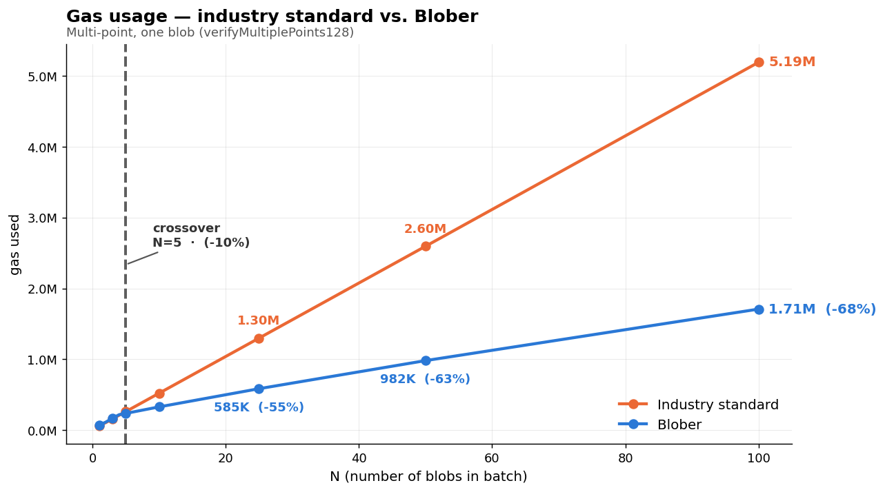
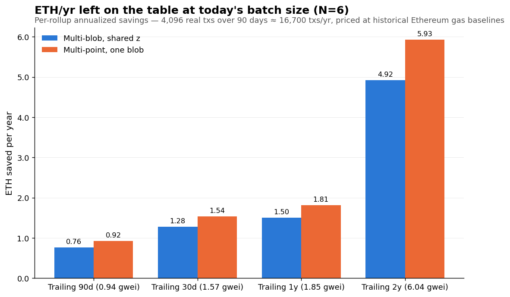
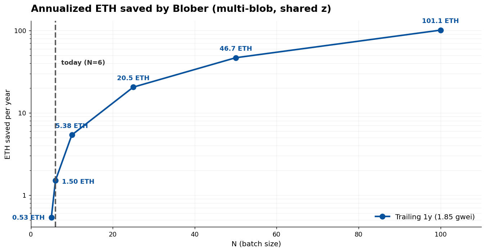

## Blober - On-chain Blob Verification Library in Solidity  
**Blober** is a Solidity library for Ethereum blob verification (and more), by introducing a well designed set of blob point verification flows it eases helps the L2 settlements.

Innovative batch KZG point evaluation approach, which is the core of Blober, is also being separately documented on it's way of becoming an EIP.
Follow the thread or read through the Ethereum Magicians topic here:
https://ethereum-magicians.org/t/eip-xxxx-batch-kzg-point-evaluation-via-bls12-381-precompile-composition/28534

---
### Problem Solution
So far L2s usually build their own blob verification flows, in a non-standardized and sometimes messy way, Blober serves as a library that abstracts away the precompile interactions and makes the verification clean and efficient.

Blober's special feature is in multi-point verifications, across multiple blobs, where by utilizing the BLS precompiles from EIP-2537 it merges the blob points into a single point, making a verification process of multiple points less costly (by much).

Blober also contains other utils that can help you checksum the specific blob hash, get a versioned hash from the blob data hash, check if blob is present in the tx and more! 

With introduction of 21 blob per block limit, Blober multi-point verification becomes increasingly effective, for L2s using Blober instead of iterative point validation, gas consumption can be reduced by **50–70%** at large batch sizes (see [benchmarks](#benchmarking-results)).

Danksharding and Block-in-Blob EIPs can further leverage usage of Blober, potentially requiring the development of new features.

---
### Build
```
$ forge build
```

### Test
```
$ forge test                                   # unit, regression, and fuzz tests
$ forge test --mc PathEquivalence --fuzz-runs 3000   # the loop/batched equivalence fuzz, harder
$ cd formal && lake exe cache get && lake build      # Lean proofs (see formal/README.md)
```

---
### Security and verification

Every 128-byte point is validated before use: canonical encoding (zero padding, coordinates < p) on every path, and an on-curve check on the 0x0A fallback, the one path where no EIP-2537 precompile sees the point. All validation runs before the Fiat-Shamir hash, and every precompile call forwards only its own gas price, so a malformed input costs a bounded amount rather than all forwarded gas.

- **Path equivalence fuzzing** (`test/PathEquivalence.t.sol`): for all three shapes, mutates a valid batch (flipped bytes, swapped proofs, off-curve points, bad padding, wrong y, ...) and asserts the 0x0A loop and the batched path accept and reject exactly the same inputs.
- **Encoding regressions** (`test/BlobVerifierEncoding.t.sol`), **coverage** (`test/BlobVerifierCoverage.t.sol`, 100% of functions), and the original unit and Fiat-Shamir regression tests (`test/BlobVerifier.t.sol`).
- **Lean 4 proofs** (`formal/`): the batched check equals a random linear combination of the single-opening checks, it is complete, and an invalid claim passes for at most one challenge value (soundness error ≤ 1/q per challenge). CI fails if a proof uses `sorry`. Assumptions (q-SDH, keccak as a random oracle, precompile correctness) are listed in [`formal/README.md`](formal/README.md).

---
### Usage

#### Install
```
$ forge install markolazic01/blober
```
#### Import
``` solidity
pragma solidity ^0.8.30;

import { BlobVerifier } from "blober/BlobVerifier.sol";
```

---
### License
MIT


---
## Benchmarking results

Side-by-side measurement of `BlobVerifier`'s 128-byte verifiers against the industry-standard EIP-4844 pattern (loop the `0x0A` precompile over 48-byte points), plus a replay of real mainnet traffic. Every number below comes from the files in `benchmarks/data/` and can be regenerated with the commands at the bottom.

## Headline

- **Batching pays from N=5 against a bare 0x0A loop** and saves **~63% (many blobs, one z), ~68% (one blob, many z) and ~51% (general shape) at N=100**.
- **Below that, Blober costs 3–13% more than a bare loop** (mostly 6–8%). That is the price of accepting 128-byte points safely: the fallback checks their encoding and that they are on the curve before compressing them for `0x0A`. If you already hold 48-byte points, the 48-byte entry points are plain loops with no such overhead.
- **Mainnet replay** (90-day window): 4,096 KZG state-update txs from a production rollup, all at N≈6, would have saved 198.5M gas (~0.152 ETH at the gas prices they paid).
- **Projected annual savings per rollup**: 1.50 ETH/yr at today's N=6 and trailing-1y gas, **101 ETH/yr if batches grow to N=100**, 331 ETH/yr at N=100 with trailing-2y gas.




## Dispatch thresholds

Each 128-byte verifier picks its path by batch size: below the threshold it loops `0x0A`, at or above it it runs one MSM + pairing. The thresholds are the first N where Blober's batched path beats Blober's own validated fallback on identical inputs (`test_threshold_crossover`, `benchmarks/data/threshold_crossover.csv`):

| Constant | Shapes | Value |
|---|---|---|
| `BATCH_THRESHOLD_128` | many blobs at one z; one blob at many z | **4** |
| `BATCH_THRESHOLD_GENERAL_128` | many blobs, one z each | **5** |



## Synthetic benchmark: gas vs N

Measured with Foundry against the real EIP-2537 / EIP-4844 precompiles (`evm_version = "osaka"`). The reference is `LoopVerifier.sol`, a stripped port of the industry-standard `verifyKzgProofs` loop without protocol-specific overhead, so it is the *best-case* baseline. Rows N=150/300/400/700 are in the CSVs.

### Many blobs, one shared z (`verifySinglePointMultipleBlobs128`)

`benchmarks/data/synthetic_gas_multi_blob_one_point.csv`

| N | 0x0A loop (48-byte) | Blober (128-byte) | Blober / loop | Saved |
|---|---|---|---|---|
| 1 | 57,148 | 61,581 | 107% | −7% |
| 2 | 107,182 | 115,950 | 108% | −8% |
| 3 | 159,729 | 172,825 | 108% | −8% |
| 4 | 212,292 | 226,474 | 106% | −6% ← first N where batching runs |
| 5 | 264,873 | 247,572 | 93% | +7% ← beats the loop |
| 10 | 527,743 | 353,307 | 66% | +34% |
| 25 | 1,316,891 | 652,098 | 49% | +51% |
| 50 | 2,634,417 | 1,120,547 | 42% | +58% |
| 100 | 5,277,522 | 2,000,014 | 37% | +63% |
| 200 | 10,622,139 | 3,851,986 | 36% | +64% |
| 500 | 27,131,064 | 10,037,523 | 36% | +64% |
| 1000 | 55,922,234 | 21,827,121 | 39% | +61% |

### One blob, many z (`verifyMultiplePoints128`)



`benchmarks/data/synthetic_gas_multi_point_one_blob.csv`

| N | 0x0A loop (48-byte) | Blober (128-byte) | Blober / loop | Saved |
|---|---|---|---|---|
| 1 | 63,034 | 71,756 | 113% | −13% |
| 2 | 106,361 | 113,530 | 106% | −6% |
| 3 | 158,192 | 167,807 | 106% | −6% |
| 4 | 210,030 | 218,166 | 103% | −3% ← first N where batching runs |
| 5 | 261,877 | 236,507 | 90% | +10% ← beats the loop |
| 10 | 521,081 | 328,476 | 63% | +37% |
| 25 | 1,298,914 | 585,253 | 45% | +55% |
| 50 | 2,596,212 | 981,714 | 37% | +63% |
| 100 | 5,193,991 | 1,709,031 | 32% | +68% |
| 200 | 10,410,999 | 3,216,484 | 30% | +70% |
| 500 | 26,234,756 | 8,044,753 | 30% | +70% |
| 1000 | 53,081,207 | 16,580,712 | 31% | +69% |

One blob at many points saves more than many blobs at one point because the batched check has a *single* commitment slot (weighted by `Σr_i`) instead of N of them. The advantage comes from the algebra, not from extra optimization.

### General shape, many blobs with one z each (`verifyMultiplePointsMultipleBlobs128`)

`benchmarks/data/synthetic_gas_multi_blob_multi_point.csv`

| N | 0x0A loop (48-byte) | Blober (128-byte) | Blober / loop | Saved |
|---|---|---|---|---|
| 1 | 57,601 | 62,168 | 107% | −7% |
| 2 | 107,797 | 116,823 | 108% | −8% |
| 3 | 160,508 | 173,984 | 108% | −8% |
| 4 | 213,235 | 231,154 | 108% | −8% |
| 5 | 265,984 | 281,380 | 105% | −5% ← first N where batching runs |
| 10 | 529,686 | 423,722 | 79% | +21% |
| 25 | 1,321,409 | 820,153 | 62% | +38% |
| 50 | 2,643,548 | 1,431,370 | 54% | +46% |
| 100 | 5,297,012 | 2,647,880 | 49% | +51% |
| 200 | 10,670,830 | 5,221,716 | 48% | +52% |
| 500 | 27,336,393 | 13,615,900 | 49% | +51% |
| 1000 | 56,572,927 | 29,469,406 | 52% | +48% |

The general shape needs one more MSM term per claim (`r_i·z_i·π_i` on the right-hand side), so it saves less and batching takes one more claim to pay off. Against a bare 48-byte loop it is still slightly behind at N=5 and ahead from somewhere between N=5 and N=10.

## Mainnet replay: 90 days of real txs

`benchmarks/data/reference_replay.json`, generated by `npm run replay` and re-priced against the current gas curves by `npm run reprice`.

We sampled all `updateStateKzgDA` calls to a production rollup contract (proxy `0xc662c410…`) over 90 days.

| Metric | Value |
|---|---|
| Sample size | **4,096 txs** |
| Time window | **~89.5 days** (~1.9 txs/hour) |
| Blobs per tx | 6 (avg 5.99) |
| Observed gas price | median 1.03 gwei, range 0.07–9.96 gwei |
| **Total gas saved** | **198,521,202** |
| **Total ETH saved** *(at the gas price each tx paid)* | **0.152 ETH** |
| Per-tx saved | 48,467 gas / 0.000037 ETH |
| Annualized rate (if traffic continues) | **16,698 txs/yr** |

**Why the absolute ETH is modest**: the rollup posts at N=6 (the EIP-7594 per-tx blob limit), just past the crossover where savings are ~15%, and the window covers a low-gas regime (median ~1 gwei). The percentage is structural; the absolute amount scales with gas price. The matrices below project it at other baselines.

## Annualized cost matrices

Per-tx savings priced at historical Ethereum daily-average gas (`benchmarks/data/avg_gas_price_daily.csv`, Etherscan export 2015–2026), times the observed traffic rate (16,698 txs/yr).

### Historical baselines

| Window | Avg gwei | Why this matters |
|---|---|---|
| Trailing 30d | 1.57 | Recent typical activity |
| Trailing 90d | 0.94 | Captures the low-gas regime |
| **Trailing 1y** | **1.85** | Most defensible "today's typical" baseline |
| **Trailing 2y** | **6.04** | Captures a broader activity cycle |

(Trailing 5y averages ~32 gwei because it includes the 2020–2022 peaks. We dropped it as not representative of forward-looking conditions.)

### Many blobs, one z: annualized ETH saved (16,698 txs/yr)

`benchmarks/data/reference_replay.json → costMatrix.multiBlob.rows[i].perYear[baseline].saved`

Capped at N=100; the synthetic tables above go to N=1000.

| N | 30d (1.57) | 90d (0.94) | **1y (1.85)** | **2y (6.04)** |
|---|---|---|---|---|
| 1 | −0.12 | −0.07 | −0.14 | −0.45 |
| 2 | −0.23 | −0.14 | −0.27 | −0.88 |
| 3 | −0.34 | −0.21 | −0.40 | −1.32 |
| 4 | −0.37 | −0.22 | −0.44 | −1.43 |
| 5 | 0.45 | 0.27 | 0.53 | 1.75 |
| **6** *(today)* | **1.28** | **0.76** | **1.50** | **4.92** |
| 10 | 4.57 | 2.74 | 5.38 | 17.60 |
| 25 | 17.40 | 10.42 | 20.51 | 67.07 |
| 50 | 39.63 | 23.74 | 46.71 | 152.74 |
| **100** | **85.80** | **51.39** | **101.14** | **330.67** |

### One blob, many z: annualized ETH saved (same traffic assumption)

`benchmarks/data/reference_replay.json → costMatrix.multiPoint.rows[i].perYear[baseline].saved`

| N | 30d (1.57) | 90d (0.94) | **1y (1.85)** | **2y (6.04)** |
|---|---|---|---|---|
| 1 | −0.23 | −0.14 | −0.27 | −0.88 |
| 2 | −0.19 | −0.11 | −0.22 | −0.72 |
| 3 | −0.25 | −0.15 | −0.30 | −0.97 |
| 4 | −0.21 | −0.13 | −0.25 | −0.82 |
| 5 | 0.66 | 0.40 | 0.78 | 2.56 |
| **6** *(today)* | **1.54** | **0.92** | **1.81** | **5.93** |
| 10 | 5.04 | 3.02 | 5.94 | 19.43 |
| 25 | 18.68 | 11.19 | 22.02 | 72.00 |
| 50 | 42.27 | 25.31 | 49.82 | 162.89 |
| **100** | **91.23** | **54.64** | **107.54** | **351.60** |

Negative values at N=1–4 are what a caller would pay *if it called Blober with 128-byte points at those sizes* instead of a bare 48-byte loop.

### Visualizations





> **N capped at 100** in both charts. Per rollup, same observed traffic rate (16,698 txs/yr) across all rows.

## Methodology and caveats

### What we measured directly

- **Synthetic gas curves**: Foundry tests on identical inputs (`fixtures_multi_blob.json`, `fixtures_multi_point.json`), measuring `gasleft()` around external calls to `LoopVerifier` and a thin wrapper around `BlobVerifier` (both in `benchmarks/`).
- **Dispatch thresholds**: both halves of each Blober verifier, called directly on the same inputs.
- **Real tx blob counts and gas prices**: pulled from public RPC + Blockscout for one contract over 90 days (4,096 txs).

### What we extrapolated or assumed

- **Execution gas only, no calldata.** The measured calls happen inside one transaction, so they include neither the 21k intrinsic cost nor calldata. Blober takes 128-byte points (192 ABI bytes each) where the loop takes 48-byte ones (128), so a real transaction pays more calldata. Pricing calldata at 4/16 gas per zero/non-zero byte, savings at N=10 drop from 34% to 28% (shared z), 37% to 34% (one blob) and 20% to 16% (general); at N=100 from 63% to 56%, 68% to 63% and 51% to 44%. At N=5 the shared-z saving drops from 7% to 3%.
- **Linear interpolation for off-grid N**: the cost matrices interpolate between measured points (measured directly up to N=1000).
- **N above 6 needs protocol changes**: EIP-7594 caps a transaction at 6 blobs, so larger N means more points per blob or protocol evolution.
- **One contract sampled**: other rollups batch differently.
- **Verification slice only**: real txs also pay for state updates, messaging, etc.
- **Daily-average gas underestimates**: state-update txs usually pay above-average gas, so the projections are likely conservative.
- **The reference loop is stripped**: real production loops carry more overhead than `LoopVerifier.sol`, so savings against them would be larger.

## Where the data lives

```
benchmarks/
├── data/
│   ├── fixtures_multi_blob.json                   ← 1000 random blobs at z=1 (input)
│   ├── fixtures_multi_point.json                  ← 1 blob at 1000 distinct z (input)
│   ├── synthetic_gas_*.csv                        ← gas curves, regenerated by `forge test`
│   ├── threshold_crossover.csv                    ← Blober fallback vs batched, N=2..8
│   ├── avg_gas_price_daily.csv                    ← Etherscan historical export, 2015–2026
│   ├── reference_replay.json                      ← per-tx mainnet replay + cost matrices
│   └── chart_*.png                                ← generated by `scripts/generate_charts.py`
│
├── scripts/
│   ├── generate_fixtures.ts                       ← npm run generate
│   ├── fetch_reference_txs.ts                     ← npm run replay / npm run reprice
│   └── generate_charts.py                         ← matplotlib chart regenerator
│
├── src/LoopVerifier.sol                           ← the comparison reference
└── test/Compare.t.sol                             ← gas measurement harness
```

## Reproducibility

From the repo root:

```bash
FOUNDRY_PROFILE=benchmark forge test     # regenerates synthetic_gas_*.csv and threshold_crossover.csv (~5s)
```

From `benchmarks/scripts/`:

```bash
npm install            # one-time: c-kzg + @noble/curves + tsx
npm run generate       # regenerates the fixture JSONs (~50s)
npm run reprice        # re-prices the saved replay against the current CSVs (offline, ~1s)
npm run replay         # re-samples mainnet: new 90-day window (~45s, ~4000 txs)
```

`npm run replay` is configurable via env vars (no API keys needed; Blockscout for tx listing, a public RPC for receipts):

```bash
WINDOW_DAYS=90 MAX_SAMPLE=5000 RPC_CONCURRENCY=10 npm run replay
```

Charts (one-time venv setup, then run anytime):

```bash
python3 -m venv benchmarks/.venv && benchmarks/.venv/bin/pip install matplotlib
benchmarks/.venv/bin/python benchmarks/scripts/generate_charts.py
```
